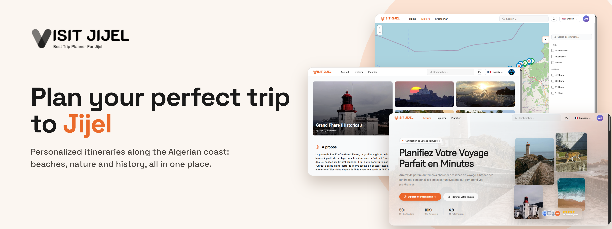
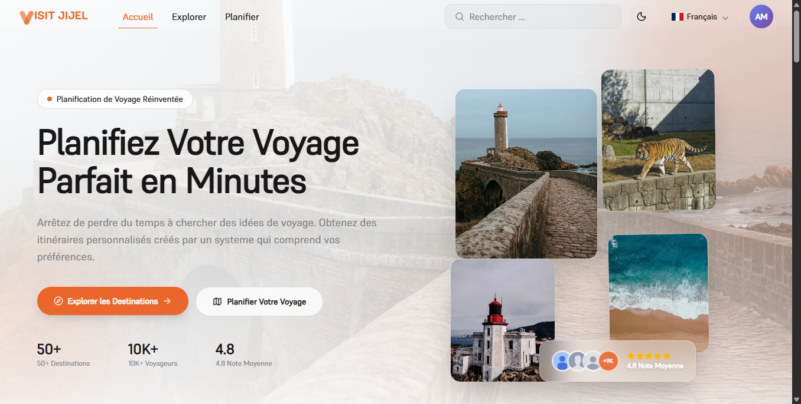
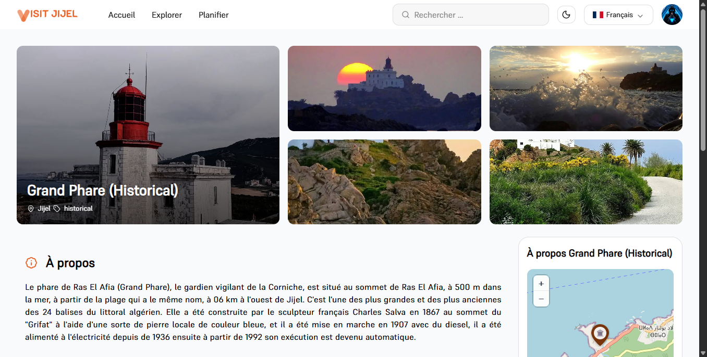
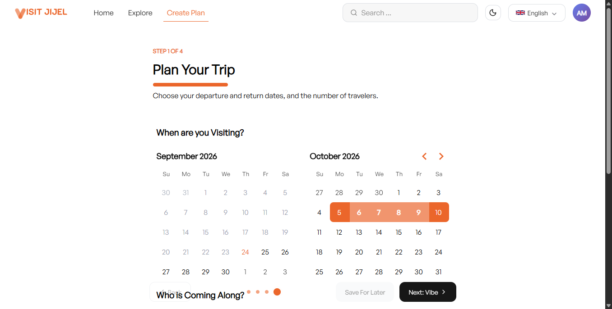

# VisitJijel — Tourism & Trip Planning

<p align="center">
  
</p>

<p align="center">
  <strong>Discover destinations. Explore hidden gems. Plan your next adventure.</strong>
</p>

<p align="center">
  <a href="https://visit-jijel.vercel.app">Live Demo</a> ·
  <a href="https://github.com/Ahmed-ziane-12/visit-jijel-admin-panel">Admin Panel</a> ·
  <a href="https://github.com/Ahmed-ziane-12/visit-jijel-backend">Backend API</a>
</p>

---

## Overview

**VisitJijel** is a tourism platform designed to help travellers discover destinations, explore local businesses, and plan personalised trips across Jijel, Algeria.

The platform brings tourism information together in one place and helps users organise their stays based on their interests, preferences, budget, and travel dates.

## Features

- **Destination Discovery** — Explore beaches, forests, historical sites, and other points of interest.
- **Interactive Map** — Discover destinations geographically using Leaflet and OpenStreetMap.
- **Tourism Directory** — Browse accommodation, restaurants, and other tourism-related businesses.
- **Personalised Itineraries** — Generate suggested travel plans based on user preferences and constraints.
- **Trip Management** — Review, refine, and organise planned trips.
- **Favourites** — Save destinations and other items for later.
- **User Profiles** — Manage personal information and trip preferences.
- **Multilingual Interface** — Support for English, French, and Arabic, where implemented.

## Screenshots

| Home | Explore | Trip Planning |
|:---:|:---:|:---:|
|  |  |  |

## Tech Stack

- **Framework:** Next.js, React, TypeScript
- **Styling:** Tailwind CSS and CSS modules were used
- **Maps:** Leaflet, OpenStreetMap
- **Internationalisation:** next-intl
- **Backend:** Laravel REST API
- **Database:** PostgreSQL (managed by the backend)

## Getting Started

### Prerequisites

- Node.js (compatible with the project's configured version)
- npm
- A running VisitJijel backend, or access to a compatible API instance

### Installation

Clone the repository:

```bash
git clone https://github.com/Ahmed-ziane-12/visit-jijel-frontend
cd visit-jijel-frontend
npm install
```

### Environment Variables

One env variable needed, pointing to the running backend URL

```env
NEXT_PUBLIC_API_URL=http://localhost:8000/api
```


### Run Locally

```bash
npm run dev
```

Open [http://localhost:3000](http://localhost:3000).

### Available Scripts

- `npm run dev` — Start the development server.
- `npm run build` — Build the production application.
- `npm run start` — Start the production server after building.
- `npm run lint` — Run linting, if configured.

## Architecture

The frontend communicates with the Laravel backend through HTTP API requests.

Its main responsibilities include:

- Rendering the public-facing interface.
- Handling navigation and user interactions.
- Collecting trip preferences and displaying itinerary results.
- Displaying destinations, businesses, and other tourism information.
- Managing client-side state and authenticated user experiences.

The backend remains responsible for data persistence, server-side validation, authorisation, and itinerary generation.

## Related Repositories

- **Admin Panel:** [VisitJijel Admin](https://github.com/Ahmed-ziane-12/visit-jijel-admin-panel)
- **Backend:** [VisitJijel Backend API](https://github.com/Ahmed-ziane-12/visit-jijel-backend)

## Project Status

VisitJijel is an evolving project. Features and interfaces may change as development progresses.
